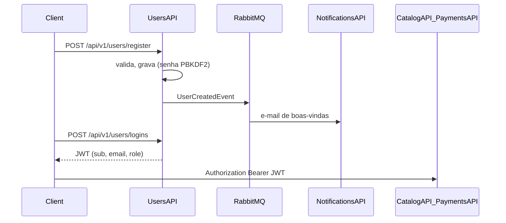

# FCG.UsersAPI

Microsserviço de **usuários** da FIAP Cloud Games (FCG), Fase 2. Faz o cadastro, a autenticação (JWT) e o gerenciamento de usuários e perfis de acesso. É o único serviço que **emite** tokens; os demais apenas os validam com a mesma chave.

O código foi extraído do monolito da Fase 1 ([IseduardoRezende/FCG](https://github.com/IseduardoRezende/FCG)), mantendo o mesmo padrão de camadas, o Result pattern, o FluentValidation e o Serilog.

## Papel no ecossistema



## Estrutura

```
01- API/FCG.Users.Api                         Controllers, Program.cs, segurança (ICurrentUser), Swagger, /health
02- Core/FCG.Users.Application                DTOs, validators, services (UserService, TokenService), IEventPublisher
02- Core/FCG.Users.Domain                     Entidades, Result pattern, filtros, interfaces de repositório
03- Infrastructure/FCG.Users.Infrastructure   EF Core + Npgsql, migrations, repositórios, PasswordHasher, MassTransit, DI
05- Tests/FCG.Users.UnitTests                 Regras de negócio (services, validators, token, hash)
05- Tests/FCG.Users.IntegrationTests          API + PostgreSQL (Testcontainers) + MassTransit Test Harness
Contracts/Events.cs                           Contratos de integração (idênticos em todos os repositórios)
k8s/                                          Deployment, Service, ConfigMap, Secret, kustomization
Dockerfile                                    Build multi-stage (sdk, depois aspnet; usuário não-root)
```

A camada Application conhece apenas a interface `IEventPublisher`; o MassTransit fica isolado na Infrastructure.

## Entidades e regras de negócio

| Entidade | Descrição |
|----------|-----------|
| `User` | Nome, e-mail (único, sempre em minúsculas), senha em hash PBKDF2 com salt, role e soft delete |
| `UserRole` | `User` (1) ou `Administrator` (2), criados por seed |

- Todo novo cadastro recebe a role `User`.
- O e-mail não pode se repetir (retorna 409).
- A senha precisa de no mínimo 8 caracteres, com letra, número e caractere especial.
- Um cadastro bem-sucedido publica o `UserCreatedEvent`.
- O usuário comum só consulta os próprios dados; listar, editar e excluir são operações exclusivas do administrador.
- A exclusão é lógica: o usuário excluído não consegue mais logar.
- O JWT contém `sub` (id), `email`, `name` e `role`, e é validado pelo Catalog e pelo Payments.

### Administrador padrão (seed)

| E-mail | Senha |
|--------|-------|
| `fcg@admin.com` | `Fcg@Admin2026!` |

## Endpoints

Base: `/api/v1/users`. Swagger em `/swagger`.

| Método | Rota | Acesso | Descrição |
|--------|------|--------|-----------|
| GET | `/roles` | Anônimo | Lista as roles |
| POST | `/register` | Anônimo | Cadastra o usuário e publica `UserCreatedEvent` (201) |
| POST | `/logins` | Anônimo | Autentica e retorna o JWT |
| GET | `/` | Admin | Lista os usuários (paginação e filtros `value`, `userRoleId`) |
| GET | `/{id}` | Admin ou o próprio usuário | Detalhe do usuário |
| PUT | `/{id}` | Admin | Atualiza o nome, o e-mail e a role |
| DELETE | `/{id}` | Admin | Soft delete |
| GET | `/health` e `/health/live` | Anônimo | Readiness (inclui o banco) e liveness |

**Cadastro**

```http
POST /api/v1/users/register
{ "name": "Player", "email": "player@fcg.com", "password": "Abcdef1!" }
```

```json
{ "value": { "id": 1, "name": "Player", "email": "player@fcg.com", "userRoleId": 1, "roleName": "User", "createdAt": "..." }, "success": true }
```

**Login**

```http
POST /api/v1/users/logins
{ "email": "player@fcg.com", "password": "Abcdef1!" }
```

```json
{ "value": { "token": "eyJhbGciOi...", "expiresAt": "..." }, "success": true }
```

Códigos de erro: 404 para credenciais inválidas, 409 para e-mail duplicado, 422 para validação e 403 para falta de permissão.

## Eventos

| Direção | Evento | Payload | Quando |
|---------|--------|---------|--------|
| Publica | `UserCreatedEvent` | `UserId`, `Name`, `Email` | Após um cadastro bem-sucedido |

O consumidor é o **NotificationsAPI**, pela fila `notifications-user-created`.

## Configuração

| Variável | Origem no k8s | Padrão local |
|----------|---------------|--------------|
| `ConnectionStrings__DbConnection` | Secret | `Host=localhost;Port=5434;Database=fcg_users;Username=postgres;Password=postgres` |
| `RabbitMq__Host` | ConfigMap | `localhost` |
| `RabbitMq__VirtualHost` | ConfigMap | `/` |
| `RabbitMq__Username` / `RabbitMq__Password` | Secret | `fcg` / `fcg` |
| `TokenSettings__Issuer` / `TokenSettings__Audience` | ConfigMap | `FCG.Users` / `FCG.Client` |
| `TokenSettings__Key` | Secret | chave de desenvolvimento (a mesma em todos os serviços) |
| `TokenSettings__DaysUntilExpires` | ConfigMap | `1` |

As migrations são aplicadas automaticamente no startup.

## Como executar

**Local (`dotnet run`)**: é preciso ter o PostgreSQL na porta 5434 e o RabbitMQ na 5672. O jeito mais simples é subir só a infraestrutura pelo repositório de orquestração:

```powershell
cd ../FCG.Orchestration; docker compose up -d postgres rabbitmq
cd ../FCG.UsersAPI; dotnet run --project "01- API/FCG.Users.Api"   # http://localhost:5101/swagger
```

Os padrões do `appsettings.json` (Postgres na porta 5434 e RabbitMQ com o usuário `fcg`) já apontam para essa infraestrutura.

**Docker**

```powershell
docker build -t fcg-users-api:latest .
```

O ecossistema completo sobe com o `docker compose` do [FCG.Orchestration](https://github.com/IseduardoRezende/FCG.Orchestration).

**Kubernetes**

```powershell
kubectl apply -k k8s          # ou: kubectl apply -f k8s/
kubectl get pods
```

Pressupõe que o Postgres e o RabbitMQ já estão no cluster (Services `postgres` e `rabbitmq`), como no FCG.Orchestration. A imagem é local (`imagePullPolicy: IfNotPresent`); no Kind, carregue-a com `kind load docker-image fcg-users-api:latest`.

## Testes

```powershell
dotnet test --project "05- Tests/FCG.Users.UnitTests/FCG.Users.UnitTests.csproj"          # 39 execuções
dotnet test --project "05- Tests/FCG.Users.IntegrationTests/FCG.Users.IntegrationTests.csproj"  # 13 execuções, requer Docker
```

- **Unitários**: cadastro (role padrão, normalização, hash, evento publicado, e-mail duplicado), login, regras de acesso, edição, soft delete, claims do JWT, política de senha e hash do admin.
- **Integração**: a API real sobre um PostgreSQL efêmero (Testcontainers), com as migrations aplicadas e o RabbitMQ substituído pelo MassTransit Test Harness. Verifica a gravação no banco, a publicação do `UserCreatedEvent` e os códigos 401, 403, 404, 409 e 422.

O detalhamento de cada cenário está em [`05- Tests/TESTS.md`](05-%20Tests/TESTS.md). O CI (`.github/workflows/dotnet.yml`) roda o build, as duas suítes e o `docker build`.
